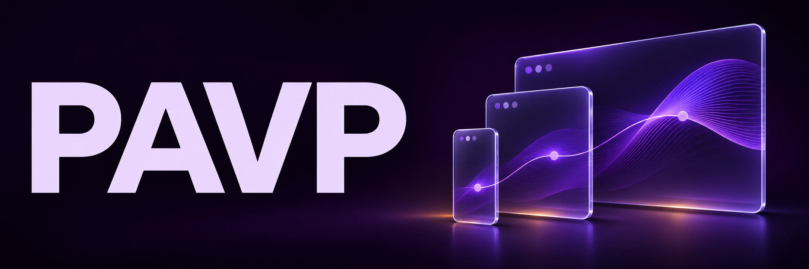

  

<h1 align="center">Progressive Adaptive Vue Platform</h1>

<strong>把每个 Vue 项目都要重做的事，先做好一遍。</strong>

从后台到大屏，用同一套 Vue + TypeScript 底座。界面跟用户走，业务由你决定。

  <a href="https://pavp.cc/"><strong>在线体验 →</strong></a>　·　
  <a href="./ARCHITECTURE.md">架构说明</a>　·　
  <a href="./docs/usage.md">开发与部署</a>

---

### 换屏幕，不换一套代码

办公后台和展示大屏用的是同一套组件。主题、字号、密度和动效可以跟着用户习惯走，不用给每个页面单独补样式。

### 让设计有个统一的出处

颜色、尺寸和交互状态从同一套设计令牌出发。做新页面时可以沿用现有规则，也可以有意地改，而不是靠猜。

### 让 AI 知道哪里能改、改完怎么验

规则就在[仓库里](./AGENTS.md)：代码放哪、哪些边界不能跨、改完跑什么检查。换人或换工具，也不用从头解释一遍。

<a href="https://pavp.cc/"><strong>打开 PAVP，亲手试一下 →</strong></a>

